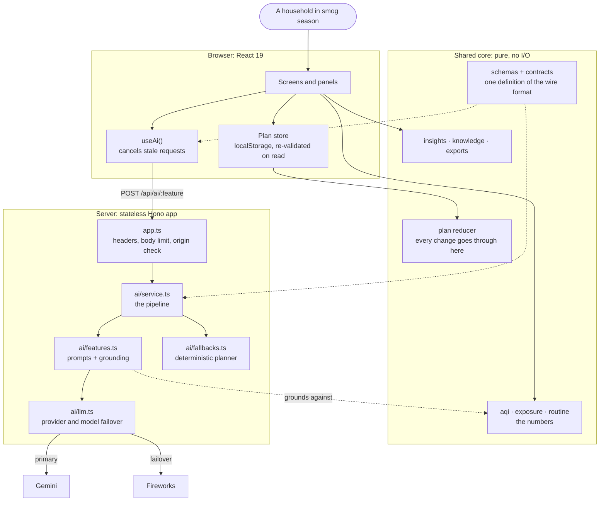
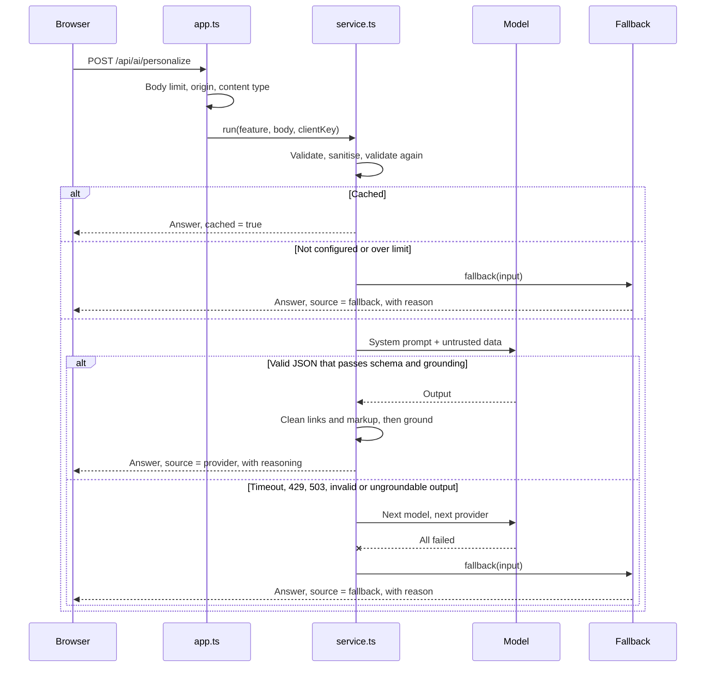

# Vayu: architecture

## 1. The one-sentence version

A React client holds the plan and does all air-quality and exposure arithmetic locally, while a small stateless Hono server is the only thing that can talk to a model, and it validates, rate-limits, grounds and, when necessary, replaces whatever the model says.

## 2. System diagram

## 3. The numbers: three pure modules

| Module                                  | Responsibility                                                                                                                                                                                                            |
| --------------------------------------- | ------------------------------------------------------------------------------------------------------------------------------------------------------------------------------------------------------------------------- |
| [`aqi.ts`](src/shared/aqi.ts)           | PM2.5 to US AQI (EPA breakpoints) and bands. A winter-inversion diurnal curve, normalised to preserve the daily mean. City baselines. Indoor PM2.5 from outdoor air, infiltration, indoor sources and a purifier's CADR   |
| [`exposure.ts`](src/shared/exposure.ts) | The day as segments (sleep, home, cooking, commute, outdoor activity) and the inhaled dose of each: breathed PM2.5 × hours × breathing rate. The dose doing nothing, now, and fully protected. The impact of each measure |
| [`routine.ts`](src/shared/routine.ts)   | The cleanest window, the peaks, whether it is safe to ventilate at all, and an explained hour-by-hour routine                                                                                                             |

All three take "now", the city and the household as parameters, so they are deterministic and run in both the browser and the server. The server uses them to ground the model; the browser uses them to render.

## 4. One AI request

## 5. Layering rules

| Layer  | Path          | Rule                                                                                             |
| ------ | ------------- | ------------------------------------------------------------------------------------------------ |
| Shared | `src/shared/` | Pure and isomorphic. No I/O, no clock, no framework. "Today" is always a parameter               |
| Server | `src/server/` | The only code that reads the environment or calls a provider. `fetch` and the clock are injected |
| Client | `src/client/` | Renders state and dispatches actions. Holds no business rules of its own                         |

These are enforced by `no-restricted-imports` in [`eslint.config.mjs`](eslint.config.mjs). CI fails if client code imports server code, which is the structural reason a key cannot reach the browser.

## 6. Key decisions

### Deterministic core, AI on top

A plan is created instantly and completely by pure code: the air, the exposure breakdown, the measures relevant to this home (from a catalogue of ten) ranked by impact, and a full routine. The AI layers household-specific detail over it. So a plan always exists, the numbers are always right, and an outage costs some personalisation rather than the product.

### The model never states a number about the household

Doses, AQI values and impacts are computed by code and rendered by the client. Prompts forbid the model from inventing them, and the model's text is never the source of a figure the user acts on. This is what makes "the direct impact of your choices" trustworthy.

### Ground the model against what the code knows

`ground()` runs inside the retry chain and checks each answer against reality:

- **Air.** `isSafeToVentilate()` is one rule shared by the routine and the AI context. When it is false, any AI suggestion to open the windows or air out the home is removed, from personalisation, the day-sheet and chat proposals. If grounding empties a day-sheet, that counts as a failed attempt and the next model gets a turn.
- **The plan.** Personalisation that repeats a measure category the plan already seeds is dropped (the exposure model credits each category once, so a second "masks" card would add clutter, not protection). The reducer applies the same rule against the live plan, which also covers the offline planner.
- **Ids.** Proposals to adopt a measure that does not exist or is already done are dropped.

Two of these rules came from running every feature against live Gemini during development, not from reasoning in advance: the model once suggested airing the home at 13:00 on an AQI 260 day, and personalisation duplicated seeded measures.

### Lenient parsing where a gap is harmless

Live models sometimes return `""` for a field they could not fill. For the free-text profile draft, which the user reviews field by field before a plan exists, an empty or unknown value is treated as "not stated" (`lenient()` in [`contracts.ts`](src/shared/contracts.ts)), so the rest of a good answer is kept. Unknown routine categories fall back to a keyword reading of the title. Everything that drives the plan directly stays strict.

### One pipeline, one registry

Each AI feature is a single entry in `AI_FEATURES`: its prompt, its grounding and its fallback. Validation, sanitising, caching, limits, failover and logging are written once in `service.ts`. Adding an eighth feature cannot forget the rate limit, because a feature has no way to skip the pipeline.

### One contract, both directions

`shared/contracts.ts` defines the input and output of each feature with Zod. The server validates requests and model output against it, and the client validates responses against it, so types and runtime checks cannot drift apart.

### The AI proposes, the reducer disposes

The assistant cannot change anything. It returns proposals as data, the user approves each one, and it then goes through the same `planReducer` as a manual edit, which refuses impossible changes. This bounds what a confused or manipulated model can do, a risk known as excessive agency.

### Plans live in the browser

There is no account or database, which removes a whole class of risks (credential storage, breach of health-adjacent personal data, access control) and makes the server stateless. The AI sees member _groups_ ("child", "respiratory"), never names. The trade-off is that plans do not sync, which is stated in the README.

## 7. Failover rules

| Situation                                          | Behaviour                                                                       |
| -------------------------------------------------- | ------------------------------------------------------------------------------- |
| 500, 502, 503, 504 (server busy)                   | Retry the same model once after ~0.4 s with jitter, then try the next model     |
| 408, 429, 404                                      | Try the next model on the same provider                                         |
| 400, 401, 403                                      | Skip that provider's other models, which cannot help, and try the next provider |
| Timeout (8 s per attempt)                          | Try the next model                                                              |
| Invalid JSON, schema failure, or grounding failure | Try the next model                                                              |
| 15 s overall deadline                              | Stop, and use the offline planner                                               |

The Gemini chain is `gemini-3.5-flash-lite` → `gemini-3.1-flash-lite` → `gemini-3.5-flash`, chosen by measuring models on a free-tier key and changeable through environment variables. Free-tier quota is per model, so each step is a different model with its own quota. A busy 503 often clears within a second, so it earns one same-model retry; a 429 means quota is spent and does not. The reserve model was added after a live check in which both lite models answered 503 for several minutes while `gemini-3.5-flash` kept answering.

## 8. Efficiency

| Technique                           | Effect                                                                                                  |
| ----------------------------------- | ------------------------------------------------------------------------------------------------------- |
| Route and panel code splitting      | 113 kB gzipped entry, with each panel about 2 kB on demand                                              |
| CI bundle budget                    | `scripts/check-bundle-size.mjs` fails the build if the budget is exceeded                               |
| Self-hosted fonts, no CSS framework | Fonts are served from the same origin, and the CSS is 7 kB gzipped after removing every unused selector |
| LRU + TTL response cache            | A repeated request returns without calling a model                                                      |
| In-flight request sharing           | A double click or a second tab shares one model call                                                    |
| Request cancellation                | A superseded request is aborted rather than left to finish                                              |
| Debounced storage writes            | Typing does not serialise every plan on each keystroke                                                  |
| Bounded data                        | Schemas cap every string and array, and only recent chat history is sent to the model                   |

## 9. Scaling

The server holds no session state, so it scales horizontally without coordination. The model provider becomes the bottleneck first, and the global limit keeps spend predictable. Beyond one instance, the rate limiter and cache should move to Redis, since both are per instance today.

## 10. Testing strategy

| Level       | Tools                  | What it covers                                                                                                                         |
| ----------- | ---------------------- | -------------------------------------------------------------------------------------------------------------------------------------- |
| Unit        | Vitest                 | Pure logic and edge cases: AQI breakpoints, the smog curve preserving its mean, purifier saturation, routine windows wrapping midnight |
| Property    | fast-check             | Invariants: AQI is monotonic in PM2.5, spreading a mean over 24 hours preserves it, no single measure ever raises the dose             |
| Contract    | Vitest                 | Lenient parsing keeps good answers with gaps, strict parsing still rejects incomplete ones                                             |
| Grounding   | Vitest                 | The model cannot recommend opening windows on an unsafe day, duplicate a measure, or adopt a measure that does not exist               |
| Integration | Vitest + `app.request` | The real HTTP app with only `fetch` stubbed, including failover, rate limits, caching and headers                                      |
| Component   | Testing Library + axe  | Real interactions and an accessibility scan of each state                                                                              |
| Browser     | Playwright + axe       | The built server in Chromium: the full journey, contrast in both themes, keyboard, phone width, CSP                                    |
| Tokens      | Vitest                 | WCAG contrast of every design-token pair, the AQI colours and the hero gradients, in both themes                                       |

Nothing talks to a real model in automated tests, so runs are deterministic, free, and safe in CI without secrets. Live-model behaviour was checked separately during development, and the grounding rules above encode what it found.
